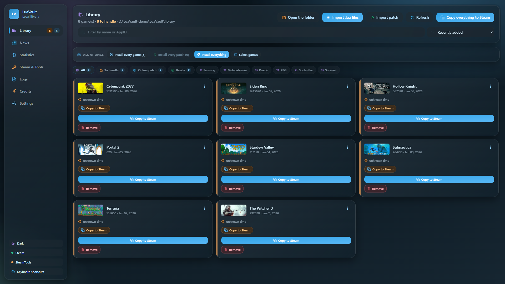
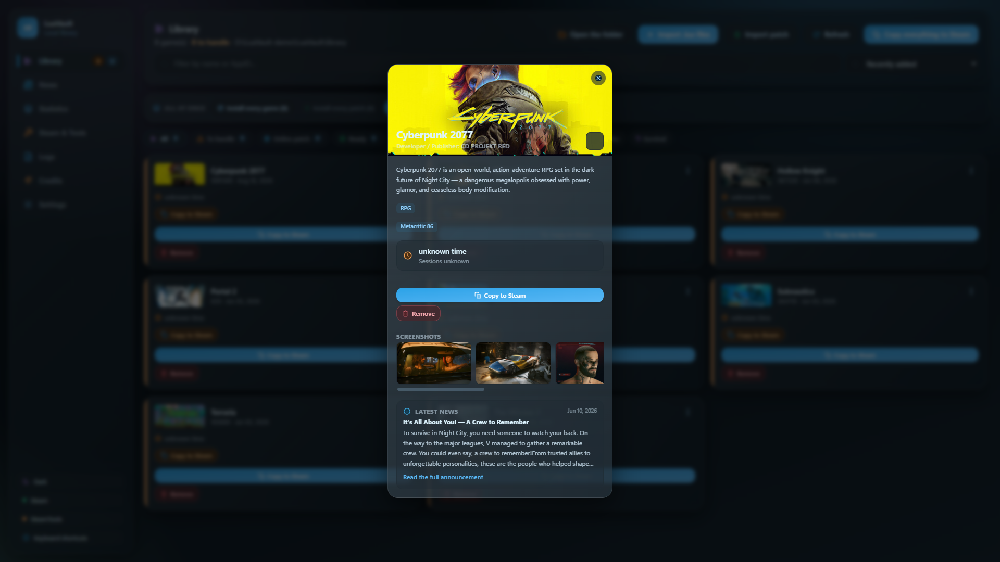
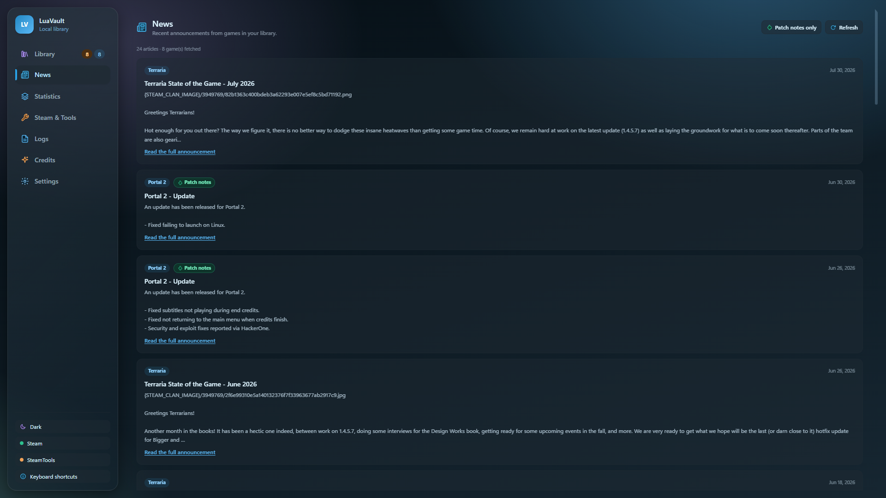
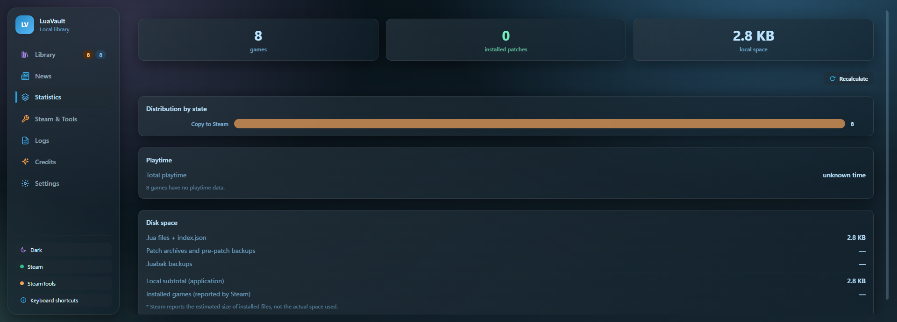
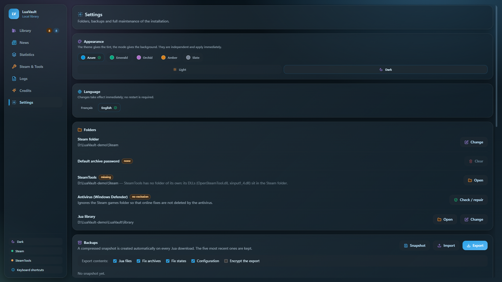

<div align="center">


# LuaVault

**Ultra-light Windows companion for a local `.lua` library.**
Frosted-glass UI, cold blue palette, a native binary of a few MB.

[](LICENSE)
[](#editions)
[](https://tauri.app)
[](https://svelte.dev)
[](https://github.com/LeGeRyChEeSe/luavault/releases/latest)
[](https://github.com/LeGeRyChEeSe/luavault/releases)
[](https://discord.gg/vSczZGT7aQ)

</div>

---

LuaVault manages a local library of `.lua` files: drag-and-drop or file-picker
import, automatic adoption of anything already sitting in `{Steam}\config\lua`,
online fixes with backup and integrity checks, and Steam/SteamTools install and
repair — all from one dependency-free window.

Current version: **1.1.5** — see [`CHANGELOG.md`](CHANGELOG.md).

## Screenshots

<table>
<tr>
<td colspan="2" width="100%"></td>
</tr>
<tr>
<td width="50%"></td>
<td width="50%"></td>
</tr>
<tr>
<td width="50%"></td>
<td width="50%"></td>
</tr>
</table>

## Features

**Library**

- **Automatic import** at startup of any `.lua` already sitting in `{Steam}\config\lua`,
  named from the Steam manifest, with a check that the game is actually installed.
- **One state per game** (`stage`): each card shows only the action that makes sense
  right now — download, copy, install, patch, repair.
- **Virtual scrolling**: the grid stays smooth past several hundred games.
- **Multi-selection** and bulk actions, which never act on what the current filter
  is hiding.
- **Download detection**: the app notices a `.lua` file, an online patch or a DRM
  bypass arriving in your downloads folder (or any folders you choose), whatever
  its source, and offers to add it. With the window in front you get a dialog,
  otherwise a Windows notification that lists the games waiting. Archives are
  opened with your default password before being offered, and nothing is added
  without your consent. A "Detected files" list also keeps older files within reach.
- **Tags**, search, sort, and statistics (stage distribution, fix counts, disk usage).
- **Playtime** and last session, read from local Steam files — no network call,
  no API key.

**Online fixes**

- **Local import of patch archives**: drag-and-drop or the Import button accepts
  `.zip`, `.rar` and `.7z` archives, matched to a game by the AppID in the
  filename (`440.zip`, `440_online_fix.zip`, `Game name (440).zip`) and
  confirmed before import. Format is detected by magic bytes, not by extension.
- **Backup of every overwritten file** before applying: uninstall restores the
  pre-patch state, even when the game has moved folders since.
- **SHA-256 integrity check** per file: a Steam update that reverts a DLL to its
  original state is flagged, with the exact file list.

**Safety and data**

- **`.luabak` backups**: five automatic rolling snapshots, manual export/import,
  and a **password-protected encrypted format** (AES-256-GCM, Argon2id).
- **Index integrity**: the library index is signed locally (HMAC); a modification
  made outside the application is detected and reported, never silently ignored.
- **Previewable cleanup**: every action is announced with its exact item count and
  its level before it runs. No level ever touches `steamapps`, `userdata`, or the
  Steam account.

**Everything else**

- **Steam-style game card**: artwork, description, developer and publisher credits,
  Metacritic score, full-size screenshots, and an update changelog. Images are cached
  on disk and stay visible offline.
- **News**: patch notes from the whole library, aggregated into one feed.
- **Automatic self-update**: the app detects its own variant (installer or
  portable), reports the available version, says what changed **since yours**,
  and installs it in one gesture.
- **Message of the day**: a signed notice (outage, warning, "do not update yet")
  shown at launch until it expires, with optional action buttons. When a Steam
  update breaks SteamTools, one click returns Steam to a build that works,
  verified against a signed hash before anything is applied, and one click
  undoes it. Every action asks for confirmation and nothing runs while a game does.
- **Notifications with the app closed** (opt-in): the message of the day and new
  versions reach you as Windows notifications, checked at logon then every 6 hours.
- **Download guard**: a tray icon watches Steam's own download log and, when
  manifest downloads keep failing, switches SteamTools to another upstream by
  itself. It can be turned off in Settings.
- **Detection and repair** of Steam and SteamTools, with elevation only when
  it's actually needed.
- **Themes** (Azure, Emerald, Orchid, Amber, Slate) and an independent light/dark
  mode.
- **Keyboard shortcuts**, full keyboard navigation, and focus traps on modal
  windows.
- **Logs** browsable inside the app: filter by level, search, copy.

## Editions

| Edition | Distribution | Data |
|---|---|---|
| Installable | NSIS installer (per-user install) | `%LocalAppData%\LuaVault` |
| Portable | zip: `LuaVault.exe` + `LuaVault.portable` marker file | next to the exe (`.\library`, `.\config.json`) |

Single binary: the presence of the `LuaVault.portable` marker file next to the
exe activates portable mode. Both paths are configurable in **Settings**.

## Development

Prerequisites: [Rust](https://rustup.rs/), Node.js 20+, WebView2 (bundled with Windows 10/11).

```bash
npm install
npm run tauri dev        # dev mode, hot reload
npm run validate         # THE gate: 9 steps, all blocking
npm run validate:quiet   # same, one line per step
```

`npm run validate` chains `cargo check`, `cargo test`, `cargo clippy -D warnings`
(app **and** update server), `vite build`, `svelte-check`, the frontend unit
tests, and the **appearance charter** (`scripts/test-charte.ts`, which turns the
project's design rules into an executable check). **It must pass before handing
anything to a user.**

### Graphical test bench

`e2e/` drives **the real application** — the binary, its WebView2 window, its
Rust backend — via `tauri-driver`, inside a disposable portable sandbox with a
fake Steam install.

```bash
npm run e2e:setup        # once: tauri-driver + the matching msedgedriver
npm run e2e:build        # the test binary — mandatory after ANY change
npm run e2e              # the graphical suite against the real window
```

### Live tests (network or real machine)

```bash
cd src-tauri && cargo test live_ -- --ignored --nocapture
```

### Build and publish

```bash
npm run build:app        # NSIS installer
npm run build:portable   # portable zip + collected into releases/<version>/
npm run icon             # regenerate icons from icon-source.png

.\scripts\publish-release.ps1 -Version 1.0.0 -DryRun   # manifest + signature only
.\scripts\publish-release.ps1 -Version 1.0.0           # sign and upload
.\scripts\publish-motd.ps1 -Fr "…" -En "…" -Hours 12  # message of the day (signed)
```

Publishing also requires the `lvrelease` binary (built by Cargo) and the
`release-primary.key` private key at the repo root. That key is gitignored:
never distribute it. `-DryRun` produces the manifest and its signature without
uploading a release.

Release notes come from [`CHANGELOG.md`](CHANGELOG.md): the script pulls the
manifest's `history` field from it, which the app uses to tell each user what
changed **since their own version**. A version missing from the changelog fails
the publication.

### Automated security checks

Every pull request towards `main` runs, on GitHub:

- **Validate**: the full `npm run validate` gate.
- **CodeQL** (`security-extended`) on the Rust, TypeScript and workflow code; it
  also runs on every push to `main` and once a week. Results are under
  Security > Code scanning.
- **Dependency review**: a pull request that brings in a dependency with a known
  high or critical advisory fails.

**Dependabot** opens weekly update pull requests for Cargo, npm and GitHub Actions
and security updates as soon as an advisory is published. Leaked-credential scanning with
push protection is enabled on the repository.

## Architecture

```
src-tauri/src/
├─ steamstore.rs  # read-only Steam store/news proxy
├─ artwork.rs     # on-disk artwork cache, served via the asset protocol
├─ discover.rs    # adopts .lua files already sitting in {Steam}\config\lua
├─ detect.rs      # Steam (registry) and SteamTools (marker files) detection
├─ vdf.rs         # libraryfolders.vdf / appmanifest_*.acf / playtime
├─ archive.rs     # RAR+ZIP extraction, zip/unzip, sha256
├─ fixes.rs       # fix lifecycle: install / verify / uninstall
├─ backup.rs      # .luabak snapshots (export/import, 5 rolling automatic ones)
├─ encrypted_backup.rs  # LVBCK-v2 format: Argon2id + framed AES-256-GCM
├─ hmac.rs        # local signature of index.json, and the re-adoption gate
├─ defender.rs    # Windows Defender exclusions
├─ cache.rs       # TtlCache + StampedCache
├─ stats.rs       # library statistics
├─ wipe.rs        # granular, previewable cleanup
├─ update.rs      # signed manifest (GitHub Releases), download, SHA-256 check
├─ motd.rs        # message of the day: signed notice, expiry, action buttons
├─ motd_run.rs    # the one place a message action runs (window or toast)
├─ steam_downgrade.rs  # Steam pinned to a verified build, and the way back
├─ steamtools_source.rs # which upstream SteamTools asks for manifest codes
├─ source_guard.rs      # follows failing downloads, decides when to switch source
├─ guard_service.rs     # tray icon and loop that carry the guard out
├─ notify.rs      # Windows notifications with the app closed, single-use tokens
├─ headless.rs    # --notify-check / --motd-action: this binary without a window
├─ downloads.rs   # watches the downloads folders and offers .lua / patch files
├─ reachability.rs # Steam reachability probe
├─ exchange.rs    # CSV/JSON export and import preview
├─ library.rs     # .lua library + index.json + copy to Steam
├─ install.rs     # elevated installs, steam:// URIs, Steam restart
├─ config.rs      # config.json, portable-mode detection
├─ commands.rs    # Tauri commands + GameStatus/derive_stage
└─ lib.rs         # wiring, logging

src-tauri/src/bin/
└─ lvrelease.rs   # Ed25519 signing of release manifests

src/
├─ App.svelte     # shell: sidebar, status pills
├─ views/         # Library, News, Stats, Tools, Logs, Settings, Credits
├─ components/    # Icons, GameSpotlight, UpdateModal, DownloadsModal, MotdModal,
│                 # WorkaroundBanner, TagEditor, Toasts, …
└─ lib/           # typed command wrappers, themes, reactive state (runes), patch
                  # import (`patch-import.ts`), virtual scroll (`virtual-scroll.ts`)
                  # and focus traps (`focus-trap.ts`)

e2e/              # graphical test bench
```

The central model is `commands::derive_stage`, which reduces every signal about
a game to a single `stage`, and `src/lib/stages.ts`, which turns that into a
label, an icon, and a tone. **New UI states are added there, never ad hoc in a
view.**

`.lua` files and fixes enter the library through local import (drag-and-drop or
a file picker) or automatic adoption of what's already sitting in
`{Steam}\config\lua` — there's no proprietary network service and nothing to
authenticate against.

## License

[MIT](LICENSE). Installing SteamTools closes Steam and requires administrator
rights; `.lua` files are your own responsibility.
